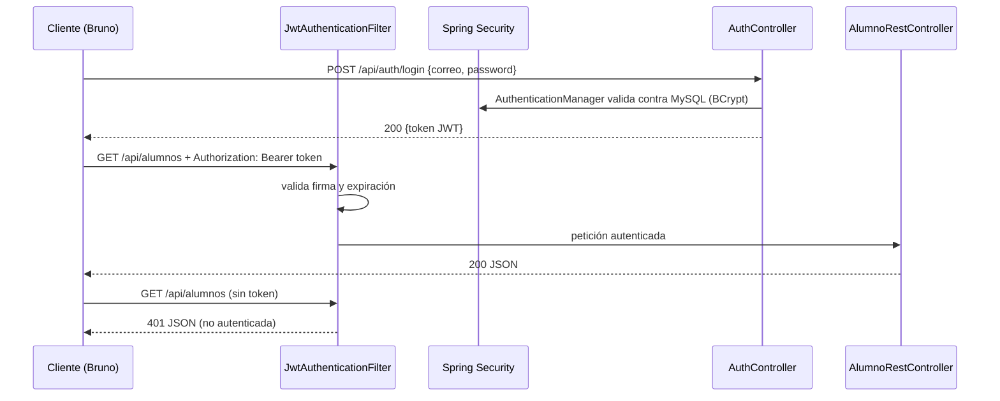
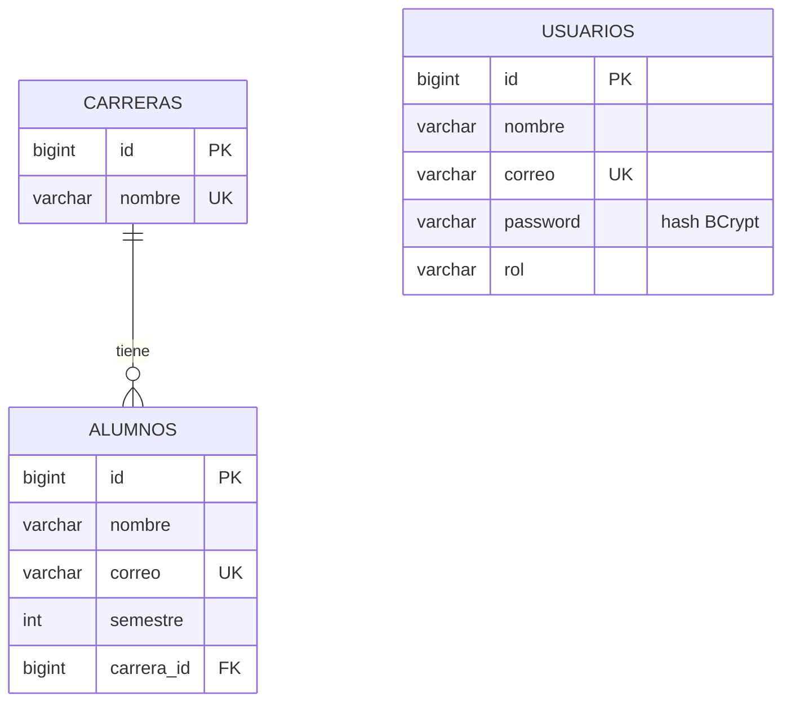
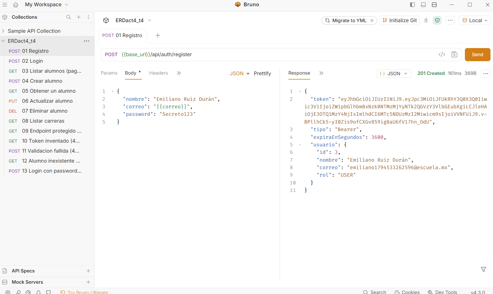
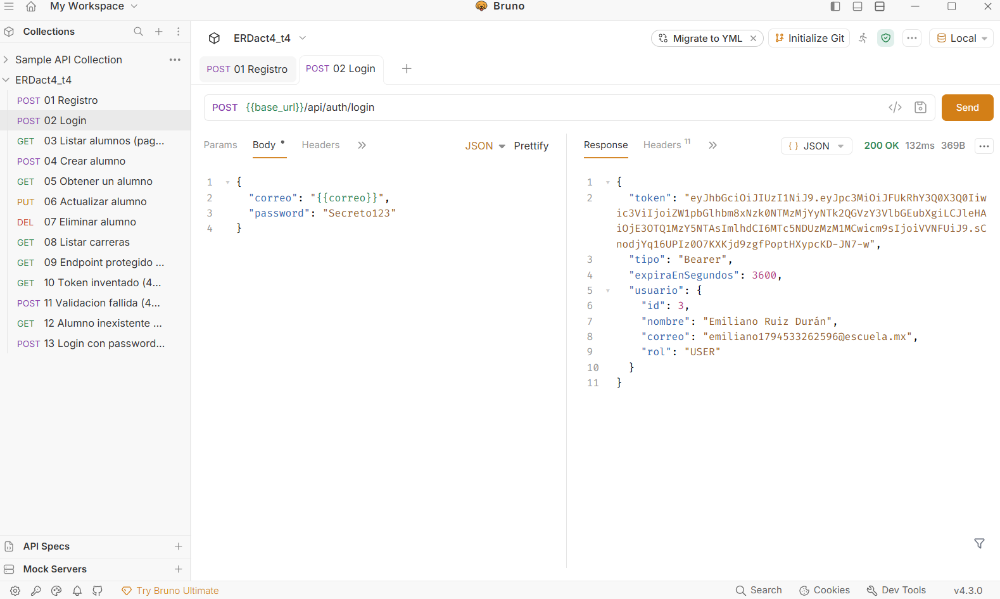
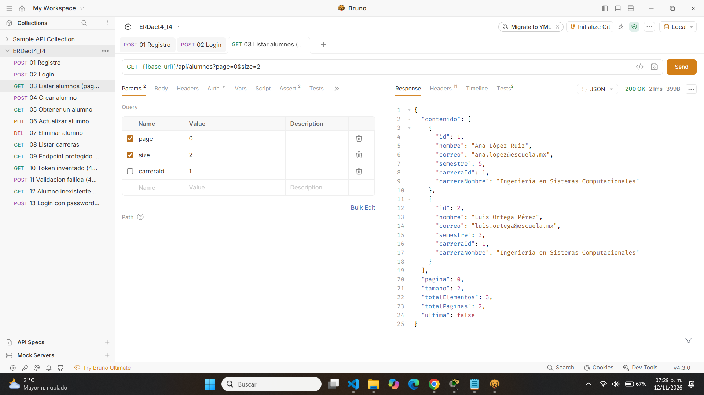
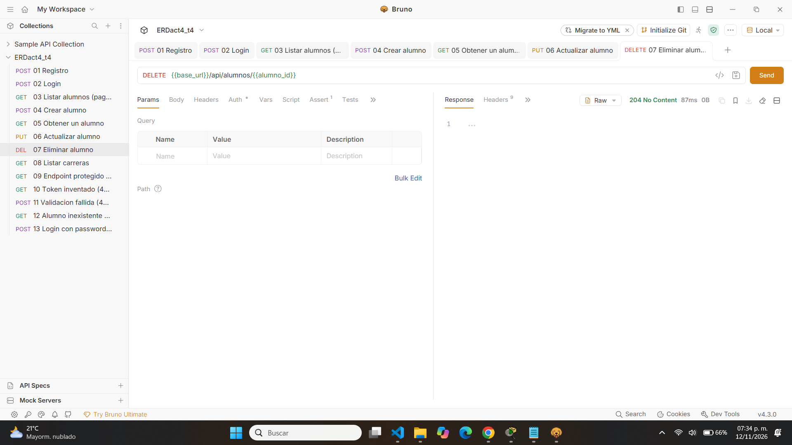
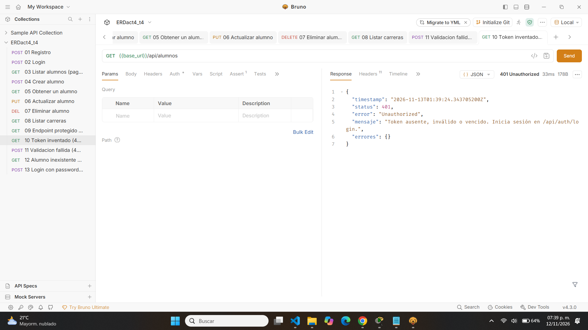

# ERDact4_t4

API REST pura con **Spring Boot, Spring Security y JWT**. Retoma las entidades **Alumno** y **Carrera** de la Actividad 3 y las expone únicamente en formato JSON (sin vistas Thymeleaf), con **autenticación real**: registro, login y un filtro que solo deja pasar peticiones con un token válido. Se prueba y documenta con **Bruno**.

**Autor:** Ruiz Durán Emiliano

## Qué hace el proyecto

- Registra usuarios (`POST /api/auth/register`) y los autentica (`POST /api/auth/login`), devolviendo un **JWT firmado**.
- Protege con un filtro de seguridad todo lo que no sea `/api/auth/**`: sin token válido la API responde **401**.
- Ofrece el CRUD completo de **alumnos** con paginación, DTOs y validación con `@Valid`.
- Nunca expone el password: se guarda con hash **BCrypt** y las respuestas usan DTOs sin ese campo.
- Responde errores en un formato JSON uniforme con el código HTTP correcto.

## Flujo de autenticación



## Entidades y relación



`USUARIOS` es independiente: guarda quién puede entrar a la API.

## Arquitectura por capas

| Capa | Archivos | Responsabilidad |
|---|---|---|
| Entity | `Alumno`, `Carrera`, `Usuario` | Tablas de la base de datos |
| Repository | `AlumnoRepository`, `CarreraRepository`, `UsuarioRepository` | Acceso a datos con `JpaRepository` (paginación con `Pageable`) |
| Service | `AlumnoService`, `CarreraService`, `AuthService` | Lógica de negocio |
| DTO | `*Request`, `*Response`, `PaginaResponse` | Qué datos entran y salen de la API |
| Controller | `AuthController`, `AlumnoRestController`, `CarreraRestController` | Reciben la petición y devuelven `ResponseEntity` |
| Security | `JwtService`, `JwtAuthenticationFilter`, `UsuarioDetailsService`, `ApiAuthenticationEntryPoint`, `ApiAccessDeniedHandler` | Generar/validar JWT y proteger rutas |
| Config | `SecurityConfig`, `DataLoader` | Cadena de filtros, BCrypt y datos de ejemplo |
| Exception | `ApiExceptionHandler`, `ErrorRespuesta` y 3 excepciones propias | Errores 400, 401, 404 y 409 |

## Endpoints

| Método y ruta | Protegido | Qué hace | Respuestas |
|---|---|---|---|
| `POST /api/auth/register` | No | Crea un usuario y devuelve token | 201, 400, 409 |
| `POST /api/auth/login` | No | Inicia sesión y devuelve token | 200, 400, 401 |
| `GET /api/alumnos?page=0&size=5&carreraId=1` | Sí | Lista paginada (filtro por carrera opcional) | 200, 401, 404 |
| `GET /api/alumnos/{id}` | Sí | Un alumno | 200, 401, 404 |
| `POST /api/alumnos` | Sí | Crea un alumno | 201, 400, 401, 409 |
| `PUT /api/alumnos/{id}` | Sí | Actualiza un alumno | 200, 400, 401, 404, 409 |
| `DELETE /api/alumnos/{id}` | Sí | Elimina un alumno | 204, 401, 404 |
| `GET /api/carreras` | Sí | Lista carreras con su total de alumnos | 200, 401 |
| `POST /api/carreras` | Sí | Crea una carrera | 201, 400, 401, 409 |

Ejemplo de respuesta de `POST /api/auth/login`:
```json
{
  "token": "eyJhbGciOiJIUzI1NiJ9...",
  "tipo": "Bearer",
  "expiraEnSegundos": 3600,
  "usuario": { "id": 1, "nombre": "Emiliano Ruiz Durán", "correo": "emiliano@escuela.mx", "rol": "USER" }
}
```

Ejemplo de respuesta paginada (`GET /api/alumnos?page=0&size=2`):
```json
{
  "contenido": [
    { "id": 1, "nombre": "Ana López Ruiz", "correo": "ana.lopez@escuela.mx", "semestre": 5, "carreraId": 1, "carreraNombre": "Ingeniería en Sistemas Computacionales" },
    { "id": 2, "nombre": "Luis Ortega Pérez", "correo": "luis.ortega@escuela.mx", "semestre": 3, "carreraId": 1, "carreraNombre": "Ingeniería en Sistemas Computacionales" }
  ],
  "pagina": 0, "tamano": 2, "totalElementos": 3, "totalPaginas": 2, "ultima": false
}
```

Ejemplo de error de validación (400):
```json
{
  "timestamp": "2026-11-11T18:00:00Z",
  "status": 400,
  "error": "Bad Request",
  "mensaje": "Hay datos inválidos en la petición.",
  "errores": {
    "correo": "Escribe un correo válido.",
    "semestre": "El semestre debe estar entre 1 y 12."
  }
}
```

### Códigos de estado usados

| Código | Cuándo |
|---|---|
| 200 | Consulta o actualización correcta, login correcto |
| 201 | Recurso creado (con encabezado `Location`) |
| 204 | Eliminado correctamente |
| 400 | Validación fallida (`@Valid`), JSON mal formado o carrera inexistente |
| 401 | Sin token, token inválido/vencido o credenciales incorrectas |
| 404 | El alumno o la carrera no existen |
| 409 | Correo o nombre ya registrado |

## Colección de Bruno

La colección está en [`bruno/ERDact4_t4`](bruno/ERDact4_t4). Para usarla:

1. Abre Bruno y elige **Open Collection** → carpeta `bruno/ERDact4_t4`.
2. Elige el entorno **Local** (o **VPS**, editando la IP en `environments/VPS.bru`).
3. Ejecuta en orden: `01 Registro` → `02 Login` → CRUD → pruebas de error. El token se guarda solo en la variable `token`.

| # | Petición | Resultado esperado |
|---|---|---|
| 01 | Registro | 201 + token |
| 02 | Login | 200 + token |
| 03 | Listar alumnos (paginado) | 200 |
| 04 | Crear alumno | 201 |
| 05 | Obtener un alumno | 200 |
| 06 | Actualizar alumno | 200 |
| 07 | Eliminar alumno | 204 |
| 08 | Listar carreras | 200 |
| 09 | **Endpoint protegido SIN token** | **401** |
| 10 | Token inventado | 401 |
| 11 | Validación fallida | 400 |
| 12 | Alumno inexistente | 404 |
| 13 | Login con password incorrecto | 401 |

Cada petición lleva `assert` para comprobar el código de estado automáticamente (también se puede correr toda la colección con *Run*).

## Tecnologías

| Herramienta | Versión |
|---|---|
| Java | 21 |
| Spring Boot | 4.1.2 (Web, Data JPA, Validation, Security) |
| JWT | `spring-security-oauth2-jose` (Nimbus), firma HS256 |
| Base de datos | MySQL |
| Pruebas | Bruno |
| Servidor | VPS de Vultr con Ubuntu |

## Cómo se realizó

### 1. Base del proyecto
Se partió de la Actividad 3: se conservaron `Alumno`, `Carrera`, sus repositorios y el `DataLoader`. Se **quitó Thymeleaf** y las vistas, y los controladores quedaron solo con `@RestController` y `ResponseEntity`.

### 2. DTOs y validación
Se separó cada DTO en `Request` (lo que entra, con `@NotBlank`, `@Email`, `@Min`, `@Max`, `@Size`) y `Response` (lo que sale). Los controladores usan `@Valid @RequestBody` y `ApiExceptionHandler` convierte los errores en un JSON con el campo y su mensaje.

### 3. Spring Security + JWT
1. `Usuario` y `UsuarioRepository` guardan los usuarios; el password se cifra con `BCryptPasswordEncoder`.
2. `UsuarioDetailsService` le enseña a Spring Security a buscar usuarios en MySQL.
3. `AuthService.login` usa el `AuthenticationManager` para verificar correo y contraseña.
4. `JwtService` genera el token (subject = correo, claim `rol`, `iat`, `exp`) y lo valida (firma y expiración).
5. `JwtAuthenticationFilter` lee `Authorization: Bearer <token>` en cada petición y autentica al usuario si el token es válido.
6. `SecurityConfig` define las reglas: `/api/auth/**` es público, todo lo demás exige autenticación, sin sesiones (`STATELESS`) y con CSRF desactivado porque no se usan cookies.
7. `ApiAuthenticationEntryPoint` responde el **401** en JSON cuando falta o falla el token.

### 4. Configuración sin credenciales en el repositorio
`application.properties` lee la base y la clave del JWT de variables de entorno, con valores por defecto solo para uso local:

```properties
spring.datasource.url=${DB_URL:jdbc:mysql://localhost:3306/erd_act4_t4?createDatabaseIfNotExist=true&serverTimezone=UTC}
spring.datasource.username=${DB_USER:root}
spring.datasource.password=${DB_PASSWORD:}
app.jwt.secret=${JWT_SECRET:clave-solo-para-desarrollo-local-cambiala-en-el-vps-2026}
```

### 5. Pruebas con Bruno
Se creó la colección con registro, login, los cuatro endpoints del CRUD, y pruebas de error (sin token, token falso, validación, 404).

### 6. Despliegue en el VPS

1. Se compiló el jar: `.\mvnw.cmd clean package -DskipTests` (genera `target/ERDact4_t4.jar`).
2. Se creó la base y un usuario propio con permisos solo sobre ella:
```sql
CREATE DATABASE erd_act4_t4 CHARACTER SET utf8mb4 COLLATE utf8mb4_unicode_ci;
CREATE USER 'erd4'@'localhost' IDENTIFIED BY '*********';
GRANT ALL PRIVILEGES ON erd_act4_t4.* TO 'erd4'@'localhost';
FLUSH PRIVILEGES;
```
3. Se creó una carpeta nueva y se subió el jar:
```bash
mkdir ~/ERDact4_t4
scp target/ERDact4_t4.jar usuario@216.238.69.86:~/ERDact4_t4/
```
4. En esa carpeta se creó un `application.properties` con los datos reales (Spring Boot lo lee antes que el del jar) y se protegió con `chmod 600`:
```properties
server.port=8087
spring.datasource.url=jdbc:mysql://localhost:3306/erd_act4_t4?serverTimezone=UTC
spring.datasource.username=erd4
spring.datasource.password=[CONTRASEÑA]
app.jwt.secret=[CLAVE_DE_MAS_DE_32_CARACTERES]
```
La clave del JWT se puede generar con `openssl rand -base64 48`.
5. Se comprobó que el puerto 8087 estuviera libre (`ss -tlnp | grep 8087`) y se abrió en el firewall: `ufw allow 8087/tcp`.
6. Se ejecutó sin tocar las actividades anteriores:
```bash
cd ~/ERDact4_t4
nohup java -jar ERDact4_t4.jar > app.log 2>&1 &
```
7. Se repitieron las pruebas de Bruno con el entorno **VPS**.

## Cómo ejecutarlo en local

Requisitos: JDK 21 y MySQL corriendo.

```powershell
$env:DB_USER = 'root'
$env:DB_PASSWORD = 'contraseña'
.\mvnw.cmd spring-boot:run
```

La API queda en http://localhost:8087. Prueba rápida:

```bash
# sin token -> 401
curl -i http://localhost:8087/api/alumnos

# registro -> 201 + token
curl -X POST http://localhost:8087/api/auth/register -H "Content-Type: application/json" \
  -d '{"nombre":"Emiliano","correo":"emi@escuela.mx","password":"Secreto123"}'

# con token -> 200
curl http://localhost:8087/api/alumnos -H "Authorization: Bearer <TOKEN>"
```

## Capturas de pantalla

**Registro** (`POST /api/auth/register`)



**Login** (`POST /api/auth/login`)



**Listar con paginación** (`GET /api/alumnos`) con token



**Obtener un alumno** (`GET /api/alumnos/{id}`)


**Crear** (`POST /api/alumnos`)


**Actualizar** (`PUT /api/alumnos/{id}`)


**Eliminar** (`DELETE /api/alumnos/{id}`)



**Endpoint protegido sin token → 401**



**Validación fallida → 400**


## Enlaces

- Repositorio: https://github.com/23161115-estud/ERDact4_t4
- API en el VPS: http://216.238.69.86:8087
- Colección de Bruno: [`bruno/ERDact4_t4`](bruno/ERDact4_t4)
